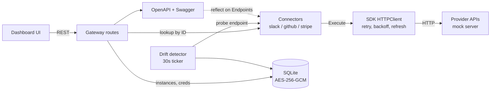

# Conduit: Operational Requirements Document (ORD)

## 1. Overview

**Conduit** is a self-hosted integration gateway written in Go. It sits between an application and third-party SaaS APIs (Slack, GitHub, Stripe today) and provides the shared plumbing every integration needs: OAuth and API-key auth, encrypted credential storage, retries and rate-limit handling, webhook verification, schema-drift detection, and generated API documentation.

Connectors implement one Go interface (`sdk.Connector`). The gateway, SDK, and dashboard are shared by all of them.

## 2. Problem Statement

Teams that integrate several third-party APIs rebuild the same pieces for each one:

- OAuth install, token exchange, and refresh, each with provider-specific quirks.
- Safe storage for customer credentials.
- Retry and backoff tuned to each provider's rate-limit signals.
- Webhook signature verification.
- Noticing when a provider's response shape changes before it breaks the integration.
- Keeping API documentation in sync with what is actually integrated.

Conduit centralizes these so a new connector only declares its auth, endpoints, and webhook handling.

## 3. Goals

1. Define a single connector contract (auth config, endpoints, webhook handler) shared by all integrations.
2. Handle OAuth2 and API-key auth, including automatic token refresh.
3. Encrypt stored credentials at rest.
4. Make outbound calls resilient: honor provider rate-limit headers and back off on transient errors.
5. Verify inbound webhook signatures before processing.
6. Detect response-schema drift against a baseline captured at install time.
7. Generate OpenAPI documentation from the registered connectors' endpoint definitions.
8. Expose metrics for requests, errors, token refreshes, webhook failures, and drift detections.
9. Run with zero configuration for local evaluation, using a built-in mock provider.

### Non-Goals

- Conduit is not a hosted service and does not manage multi-tenant billing.
- Conduit does not yet ship connectors beyond Slack, GitHub, and Stripe.
- Conduit does not implement gateway-level authentication of its own API callers; deploy it behind your own network controls.

## 4. Functional Requirements

| ID | Requirement | Implemented in |
|----|-------------|----------------|
| FR1 | A connector exposes metadata, auth config, endpoint definitions, and a webhook handler through `sdk.Connector`. | `sdk/connector.go` |
| FR2 | The gateway lists the connector catalog and installs a connector instance via OAuth2 (random `state`, callback, token exchange) or API key. | `gateway/routes_catalog.go` |
| FR3 | Credentials are encrypted with AES-256-GCM (random nonce per value) before being written to SQLite. | `gateway/db.go` |
| FR4 | Executing an endpoint loads the instance and decrypted credentials, builds an HTTP client with a token-refresh hook, and runs the endpoint under a 30-second timeout. | `gateway/routes_v1.go` |
| FR5 | The HTTP client retries transient failures with exponential backoff and jitter, and honors Slack `Retry-After` and GitHub `X-RateLimit-*` headers. | `sdk/client.go` |
| FR6 | Errors are classified as transient or permanent and recorded in metrics. | `sdk/errors.go` |
| FR7 | Inbound webhooks at `/webhooks/{instance_id}` are passed to the connector, which verifies the HMAC-SHA256 signature; failures return `401` and are counted. | `gateway/routes_webhook.go`, `sdk/webhook.go` |
| FR8 | At install, a baseline of the response shape is stored per instance. | `gateway/routes_catalog.go` |
| FR9 | A background worker polls every 30 seconds, diffs live response shape against the baseline, and posts an alert to `CONDUIT_ALERT_WEBHOOK_URL` if configured. | `gateway/drift.go` |
| FR10 | `/openapi.json` and `/docs` are generated at runtime, using `reflect` on each endpoint's input and output structs. | `gateway/openapi.go` |
| FR11 | `/metrics` exposes Prometheus metrics. | `gateway/metrics.go` |
| FR12 | A dashboard at `/ui/` supports catalog, install, instance management, and endpoint execution. | `ui/` |
| FR13 | `conduit-scaffold` generates a connector skeleton from an OpenAPI 3.x JSON spec. | `cmd/conduit-scaffold` |

## 5. Non-Functional Requirements

- **Security**: Credentials are encrypted at rest. With `CONDUIT_ENV=production`, startup fails unless `CONDUIT_ENCRYPTION_KEY` is exactly 32 bytes.
- **Resilience**: Outbound calls respect provider rate limits and back off on transient errors. Execution is bounded by a 30-second timeout and webhook handling by a 10-second timeout.
- **Operability**: The service is a single static binary with an embedded SQLite file (pure-Go driver, no CGO), shipped as a distroless Docker image.
- **Observability**: Request latency, request errors, token refreshes, webhook failures, and drift detections are exported as Prometheus metrics.
- **Extensibility**: Adding a connector means implementing `sdk.Connector` and registering it in `NewGateway`.

## 6. Architecture Summary

## 7. Tech Stack

Go, `net/http`, SQLite (`modernc.org/sqlite`), Prometheus client, OpenAPI 3.x with Swagger UI, AES-256-GCM (`crypto/aes`, `crypto/cipher`), Docker.

## 8. Verification

- `go test ./...` covers the SDK client, pagination, and webhooks, the Stripe connector, the gateway, the mock server, and the scaffolder.
- The mock provider lets the full install, execute, webhook, and drift flow run locally with no external accounts.

## 9. Known Gaps and Open Questions

- Connectors currently build their OAuth and API URLs from the mock host. Making provider base URLs configurable is required before targeting live APIs.
- Drift probe requests are built per connector inside the drift worker (Slack and GitHub today). Moving probe construction into the connector interface would remove that coupling and cover Stripe.
- State lives in one SQLite file and pending OAuth states are held in memory, so the gateway is single-node and a restart interrupts in-flight installs.
- The gateway API has no caller authentication yet.
- The Slack and GitHub connectors have no dedicated tests.
