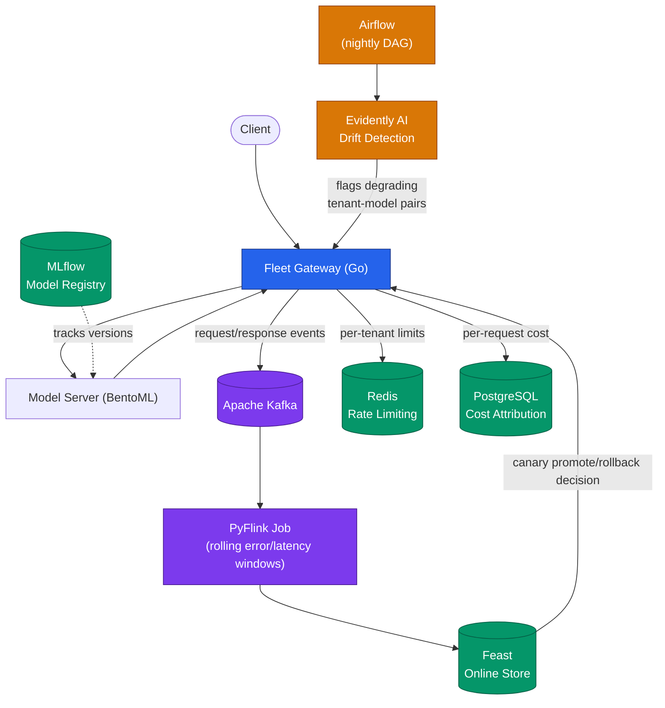

# Fleet — Operational Requirements Document (ORD)

## 1. Overview

**Fleet** is a multi-tenant model-serving gateway that sits in front of ML inference endpoints, routing and governing traffic for multiple tenants and multiple models per tenant. It combines real-time stream processing for canary safety decisions with scheduled batch jobs for drift detection, while enforcing rate limits and cost attribution per tenant.

Fleet extends design patterns from **Conduit** (a prior Go SDK for third-party integrations with AES-256-GCM credential security), applying the same credential-handling and API-client conventions to a live serving system.

## 2. Problem Statement

Serving ML models to multiple tenants introduces risks that a single-tenant setup doesn't have:

- A bad model rollout for one tenant can silently degrade latency or accuracy without fast detection.
- Tenants share infrastructure, so noisy-neighbor traffic can starve others without rate limiting.
- Model quality drifts over time as production data shifts, and this is easy to miss without scheduled monitoring.
- Without per-tenant cost attribution, infra spend can't be fairly billed or capacity-planned.

Fleet addresses all four by combining real-time stream monitoring, scheduled drift detection, and enforcement (rate limiting + cost tracking) in one gateway.

## 3. Goals

1. Route inference requests per tenant/model with sub-second added latency from the gateway itself.
2. Detect model degradation (error rate, latency) in near real time and support automatic canary rollback.
3. Detect longer-term data/model drift on a scheduled cadence and flag degrading tenant-model pairs.
4. Enforce per-tenant rate limits to prevent noisy-neighbor effects.
5. Attribute infra cost per tenant for chargeback/capacity planning.

### Non-Goals

- Fleet does not train or fine-tune models — it only serves and monitors already-trained models.
- Fleet does not manage model artifact storage long-term (delegated to MLflow/BentoML registries).

## 4. Functional Requirements

| ID | Requirement |
|----|-------------|
| FR1 | Gateway accepts inference requests, authenticates the tenant, and routes to the correct model version. |
| FR2 | All requests/responses are streamed to Kafka for downstream processing. |
| FR3 | A PyFlink job consumes the stream and computes rolling per-tenant/per-model error rate and latency windows. |
| FR4 | Rolling window metrics are written to Feast (online store) and used to drive canary promote/rollback decisions. |
| FR5 | Gateway enforces canary rollback automatically when a model-tenant pair breaches a configured error/latency threshold. |
| FR6 | An Airflow DAG runs nightly Evidently AI drift detection jobs per tenant-model pair and flags degrading pairs. |
| FR7 | Gateway enforces Redis-backed per-tenant rate limits (requests/sec, configurable per tenant tier). |
| FR8 | Gateway logs per-request cost (compute + model tier) to PostgreSQL for per-tenant cost attribution. |
| FR9 | Model artifacts are packaged/served via BentoML and tracked via MLflow. |

## 5. Non-Functional Requirements

- **Latency**: Gateway routing overhead should stay under 10ms p99, excluding model inference time.
- **Availability**: Gateway should tolerate a single node failure without dropping requests (K8s replica sets).
- **Scalability**: Support 10+ tenants and horizontal scaling of gateway replicas independent of the Flink job.
- **Observability**: All rollback/drift-flag events must be logged and queryable for post-hoc review.

## 6. Architecture Summary

## 7. Tech Stack

Go (gateway, Kafka producer/consumer, Redis rate limiting, Postgres cost attribution, Feast client calls), Apache Kafka, PyFlink, Feast, Redis, MLflow, BentoML, Airflow, Evidently AI, Docker, Kubernetes.

## 8. Success Metrics

- Canary rollback triggers within the configured rolling window (target: under 2 minutes from degradation onset).
- Drift detection flags surfaced within 24 hours of onset (nightly batch cadence).
- Zero cross-tenant rate-limit breaches under load testing.
- Cost attribution accuracy validated against actual per-tenant compute usage.

## 9. Risks / Open Questions

- PyFlink job state size at higher tenant/model counts — may need windowed state TTL tuning.
- Cold-start latency for newly onboarded tenants before rolling windows have enough data.
- Whether canary rollback should be fully automatic or require human approval above a severity threshold.
