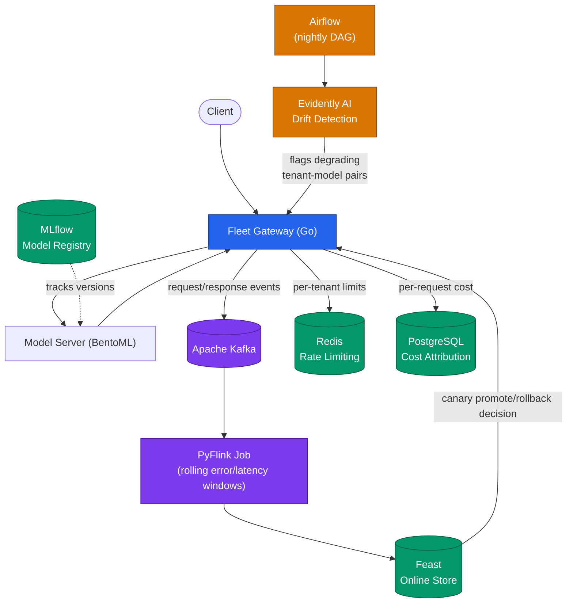

# Fleet

**Multi-Tenant Model Serving Gateway**

Fleet is a model-serving gateway that routes inference traffic across multiple tenants and models, using real-time stream processing to drive canary promote/rollback decisions and scheduled drift detection to catch longer-term model degradation — all while enforcing per-tenant rate limits and cost attribution.

Fleet extends the credential-security and API-client patterns from [Conduit](https://github.com/navyabijoy/conduit-go) (a Go SDK for third-party integrations) into a live, multi-tenant serving system.

## Features

- **Tenant-aware routing** — requests are authenticated and routed to the correct model version per tenant.
- **Real-time canary safety** — request/response events stream through Kafka into a PyFlink job that computes rolling per-tenant/per-model error rate and latency windows, served via Feast to drive automatic canary promote/rollback.
- **Scheduled drift detection** — a nightly Airflow DAG runs Evidently AI drift checks per tenant-model pair and flags degrading pairs.
- **Rate limiting** — Redis-backed per-tenant request throttling to prevent noisy-neighbor effects.
- **Cost attribution** — per-request cost logging to PostgreSQL for per-tenant chargeback and capacity planning.
- **Model packaging & tracking** — models are served via BentoML and versioned/tracked via MLflow.

## Architecture



See [ORD.md](./ORD.md) for the full operational requirements document.

## Tech Stack

| Layer | Technology |
|---|---|
| Gateway / routing | Go |
| Streaming | Apache Kafka |
| Stream processing | PyFlink |
| Feature/online store | Feast |
| Rate limiting | Redis |
| Cost attribution | PostgreSQL |
| Model tracking | MLflow |
| Model serving | BentoML |
| Scheduling | Airflow |
| Drift detection | Evidently AI |
| Deployment | Docker, Kubernetes |

## Project Structure

```
fleet/
├── gateway/          # Go gateway service (routing, rate limiting, cost attribution)
│   ├── cmd/
│   ├── internal/
│   │   ├── router/
│   │   ├── ratelimit/
│   │   ├── cost/
│   │   └── kafka/
│   └── go.mod
├── streaming/         # PyFlink job for rolling error/latency windows
│   └── rolling_metrics_job.py
├── drift/             # Evidently AI drift detection scripts
│   └── drift_check.py
├── dags/              # Airflow DAGs
│   └── nightly_drift_dag.py
├── models/            # BentoML service definitions
├── deploy/            # Kubernetes manifests, Dockerfiles
├── ORD.md
└── README.md
```

## Getting Started

### Prerequisites

- Go 1.22+
- Python 3.10+
- Docker & Kubernetes (kind/minikube for local dev)
- Kafka, Redis, PostgreSQL (see `deploy/docker-compose.yml`)

### Local Setup

```bash
# Clone the repo
git clone <repo-url> && cd fleet

# Start infra dependencies
docker compose -f deploy/docker-compose.yml up -d

# Run the gateway
cd gateway && go run cmd/main.go

# Run the PyFlink job
cd streaming && python rolling_metrics_job.py

# Deploy Airflow DAGs
cp dags/*.py $AIRFLOW_HOME/dags/
```
