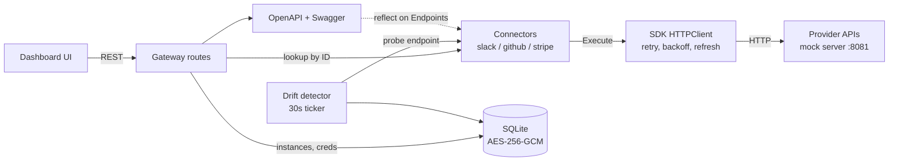

# Conduit

[](LICENSE)


**A self-hosted integration gateway written in Go.** Conduit gives third-party API integrations one shared layer for OAuth, encrypted credential storage, retries and rate limits, webhook verification, and schema-drift detection, so each new connector only has to describe its own endpoints.

> Runs end to end against a built-in mock provider, so you can try the whole flow with no accounts or keys.


## Contents

- [Quick start](#quick-start)
- [What it does](#what-it-does)
- [Architecture](#architecture)
- [API reference](#api-reference)
- [Configuration](#configuration)
- [Adding a connector](#adding-a-connector)
- [Project layout](#project-layout)
- [Testing](#testing)
- [Roadmap](#roadmap)
- [License](#license)

## Quick start

No API keys, signup, or config needed.

```bash
git clone https://github.com/navyabijoy/conduit-go.git
cd conduit-go
go run ./cmd/gateway
```

Or with Docker:

```bash
docker build -t conduit .
docker run -p 8080:8080 -p 8081:8081 conduit
```

Open **http://localhost:8080/ui/**.

### Walkthrough

1. **Catalog**: Slack, GitHub, and Stripe are listed with the scopes they request. Click **Install** on Stripe (API-key auth, the simplest).
2. Enter any non-empty key, such as `sk_test_demo`. It is validated against the mock backend.
3. Conduit encrypts the key with AES-256-GCM and stores it in SQLite. The new instance appears under **Instances** with status `active`.
4. **Execute** an endpoint such as `list_charges` and see the response.
5. Install Slack or GitHub to see the OAuth2 flow: redirect, consent on the mock provider, callback, token exchange.
6. **Metrics** links to `/metrics` (Prometheus) and `/docs` (Swagger UI).


## What it does

| Feature | How it works | Where |
|---|---|---|
| **Connector interface** | A connector implements `Metadata`, `AuthConfig`, `Endpoints`, and `HandleWebhook`. Auth, pagination, and webhook contracts are shared. | `sdk/connector.go` |
| **OAuth2 and API-key auth** | OAuth install flow with a random `state` value. The HTTP client refreshes tokens through a hook when they expire or the API returns `401`. | `gateway/routes_catalog.go`, `sdk/client.go` |
| **Encrypted credentials** | AES-256-GCM with a random nonce per value, stored in SQLite. In production (`CONDUIT_ENV=production`) startup fails without a 32-byte key. | `gateway/db.go` |
| **Rate limits and retries** | Honors Slack's `Retry-After` and GitHub's `X-RateLimit-*` headers. Other failures use exponential backoff with jitter. Errors are classed as transient or permanent. | `sdk/client.go`, `sdk/errors.go` |
| **Pagination** | A shared paginator abstraction that endpoints can plug into. | `sdk/pagination.go` |
| **Webhook verification** | HMAC-SHA256 check of the inbound signature before an event is accepted. | `sdk/webhook.go`, `gateway/routes_webhook.go` |
| **OpenAPI and Swagger UI** | The spec is generated at runtime. Go `reflect` turns each endpoint's input and output structs into OpenAPI schemas. | `gateway/openapi.go` |
| **Drift detection** | A goroutine polls every 30 seconds, flattens each response into a field-to-type map, diffs it against the baseline captured at install, and posts an alert to `CONDUIT_ALERT_WEBHOOK_URL` if set. | `gateway/drift.go` |
| **Metrics** | Prometheus metrics for request latency, request errors, token refreshes, webhook failures, and drift detections. | `gateway/metrics.go` |
| **Connector scaffolding** | `conduit-scaffold` generates a connector skeleton from an OpenAPI 3.x JSON spec. It uses templates, or Gemini when `GEMINI_API_KEY` is set. | `cmd/conduit-scaffold` |

## Architecture

The gateway is a single Go binary. The dashboard is plain static files served by the same process.



**Executing an endpoint** (`POST /v1/instances/{id}/endpoints/{name}`):

1. Load the instance from SQLite and look up its connector in the registry.
2. Find the endpoint by name, then load and decrypt the instance's credentials.
3. Build an `sdk.HTTPClient` with a token-refresh hook and call the endpoint's `Execute` under a 30-second timeout.
4. Record latency and error metrics, then return the provider's response.

## API reference

| Method | Path | Purpose |
|---|---|---|
| `GET` | `/v1/connectors` | List the connector catalog |
| `POST` | `/v1/connectors/{id}/install` | Start an install (OAuth redirect, or API-key submit) |
| `GET` | `/oauth/callback` | OAuth redirect target |
| `GET` | `/v1/instances` | List installed instances |
| `GET` / `DELETE` | `/v1/instances/{id}` | Fetch or remove an instance |
| `POST` | `/v1/instances/{id}/endpoints/{name}` | Execute a connector endpoint |
| `POST` | `/webhooks/{instance_id}` | Receive a signed provider webhook |
| `GET` | `/openapi.json`, `/docs` | OpenAPI spec and Swagger UI |
| `GET` | `/metrics` | Prometheus metrics |
| `GET` | `/ui/` | Dashboard |

## Configuration

Nothing is required for the local demo. For a real deployment, copy `.env.example` to `.env`.

| Variable | Purpose |
|---|---|
| `CONDUIT_ENV` | Set to `production` to require an encryption key and webhook secret at startup |
| `CONDUIT_ENCRYPTION_KEY` | Base64 of 32 random bytes (`openssl rand -base64 32`), or a raw 32-character string; encrypts stored credentials. Development mode uses a built-in key, so set your own for real data. |
| `CONDUIT_WEBHOOK_SECRET` | Shared HMAC secret for webhook signatures. Required in production; the built-in default is public. |
| `CONDUIT_ALERT_WEBHOOK_URL` | Optional URL that receives drift alerts |

Flags on `cmd/gateway`: `-addr` (default `:8080`), `-db` (default `./conduit.db`), `-mock-addr` (default `:8081`; the mock provider always runs), `-webhook-secret`.

## Adding a connector

1. Create `connectors/<name>/` with a type that implements `sdk.Connector` (`connectors/stripe/` is the shortest example). Declare each endpoint with its name, method, path, input and output structs, and an `Execute` function. The structs feed the generated OpenAPI spec.
2. Register it in the `registry` map in `NewGateway` (`gateway/server.go`).
3. Optionally generate the skeleton first:
   ```bash
   go run ./cmd/conduit-scaffold -spec ./openapi.json -out ./connectors/myservice
   ```

The connector itself needs no changes to the SDK.

## Project layout

| Path | Contents |
|---|---|
| `sdk/` | Connector interface, HTTP client (retry, backoff, rate limits, token refresh), auth types, errors, pagination, webhook verification |
| `connectors/` | `slack/`, `github/`, `stripe/` |
| `gateway/` | HTTP server, routes, SQLite and encryption, drift detector, metrics, OpenAPI generation |
| `mock/` | Mock Slack, GitHub, and Stripe provider for the demo and tests |
| `cmd/gateway/` | Gateway binary |
| `cmd/conduit-scaffold/` | Connector generator |
| `ui/` | Dashboard (HTML, CSS, JS; no build step) |
| `docs/` | Landing page (GitHub Pages) |

## Testing

```bash
go test ./...
```

Covers the SDK (client, pagination, webhooks), the Stripe connector, the gateway, the mock server, and the scaffolder. The Slack and GitHub connectors have no tests of their own yet.

## Roadmap

- Make provider base URLs configurable so connectors can target live APIs as well as the mock.
- Move drift probe construction into the `Connector` interface so any connector can be monitored.
- Add gateway API authentication.
- Add tests for the Slack and GitHub connectors.

## License

MIT. See [LICENSE](LICENSE).
